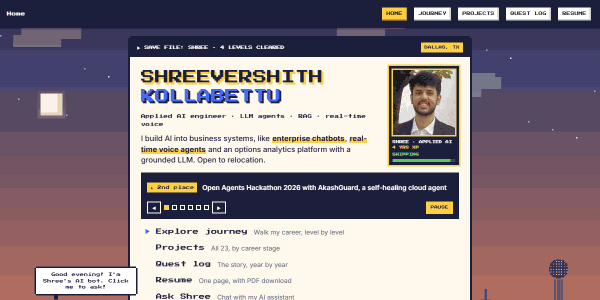

  

# Hey, I'm Shreevershith 👋

I'm an **Applied AI Engineer** in Dallas, building agentic systems, real-time voice agents and LLM products that hold up in production. Right now I'm the sole developer rebuilding **OptionFormulator**, a real-time options analytics platform, at Vernus Technologies. Before that, I built voice-to-action and voice-agent systems at an early-stage startup and at Implify, and enterprise chatbots and .NET systems at Infosys and UT System.

I care about agents that check their own work: grounded answers, human approval where it matters, and evals and tracing so you can see why something happened.

Open to **Applied AI, AI Engineer and Forward Deployed** roles, especially teams shipping agentic systems to real users. Open to relocation.

> 🎮 My [portfolio](https://shreevershith.com/) is a pixel-art career game: walk through four career levels, ask a RAG chatbot about my work, or press Space and play Bug Run.

  
   Home → Bug Run → the journey. <a href="https://shreevershith.com/">Play it live</a>.

---

## 🏆 Highlights

- 🥇 **1st place**, Kaggle emotion-classification challenge
- 🥈 **2nd place**, Open Agents Hackathon 2026 (AkashGuard)
- 📄 **First-author paper**, Springer LNNS Vol. 565 (photometric redshift with deep learning)
- 🏅 **Infosys Insta Award**: a multilingual chatbot that lifted lead qualification 13%

---

## 💼 Recent work

- **Vernus Technologies, Software Engineer (Analytics Platform), Jul 2026 – now:** sole developer rebuilding OptionFormulator from legacy .NET into Python + TypeScript on Azure. The platform runs a **15s options scan cycle** across **22 strategies**, has **230 tests** checked against the legacy system, and uses a grounded LLM to explain each pick while code supplies every number.
- **Stealth Startup, Software Engineer (Forward Deployed), Jun – Jul 2026:** voice-to-action that turns live conversations into reviewable tasks, with human approval gates and idempotent execution.
- **Implify, AI Engineer (Forward Deployed), Oct 2025 – Jun 2026:** an eldercare voice assistant with a **4.5s median time to first audio** and a 6-layer filter against speech-to-text hallucinations.

---

## 🚀 Featured projects

### 🔹 [AkashGuard](https://github.com/shreevershith/akashGuard): *Open Agents Hackathon 2026 · 2nd place 🥈*
A self-healing agent for decentralized cloud. Llama 3.3 70B diagnoses failing deployments, confidence scoring picks the recovery action, and workloads are redeployed across Akash providers with no human in the loop. Decision traces are in Langfuse.
`Python` `FastAPI` `Akash Network` `Llama 3.3 70B` `Langfuse` `Telegram`

### 🔹 [Emotion Detection with Transformers](https://github.com/shreevershith/emotion_detection_using_transformers_kaggle): *Kaggle 1st place 🥇* · [demo](https://huggingface.co/spaces/shreevershith/emotionDetectionUsingQwen3)
Multi-label emotion classification over 1M+ tweets. I benchmarked RoBERTa, DistilBERT and ALBERT, then fine-tuned Qwen3-0.6B with 4-bit QLoRA. Macro-F1 went from **0.74 to 0.81** with per-class thresholds and synonym augmentation.
`PyTorch` `Qwen3` `QLoRA` `Hugging Face` `W&B`

### 🔹 [InferScope](https://inferscope.vercel.app): *live LLM cost and performance dashboard* · [repo](https://github.com/shreevershith/inferscope)
Compares LLM price, ELO and infrastructure across **15 API providers** and **10 GPU setups**. Includes a cost calculator and a Groq-powered advisor grounded in the live dashboard data, with rate limiting and prompt-injection defenses.
`React` `Vite` `Zustand` `Tailwind` `Recharts` `Groq` `Vercel`

### 🔹 [DealGraph](https://github.com/shreevershith/dealgraph): *AWS × Anthropic × Datadog GenAI Hackathon 2026*
Pitch deck in, confidence-scored deal memo out. Every claim is routed to graph, web or LLM verifiers, with OpenTelemetry tracing end to end.
`Python` `FastAPI` `Strands Agents` `Next.js` `Memgraph` `OpenTelemetry`

### 🔹 [Sidewalk](https://github.com/shreevershith/sidewalk): *YC hackathon* · [demo](https://vibeapps.dev/s/sidewalk)
Paste a local business link and get a week of growth moves: rivals, offers, posts, events and leads, from **6 agents** plus a grounded chat.
`Multi-agent` `LLM APIs` `Next.js`

### 🔹 [Cactus Voice](https://github.com/shreevershith/CactusWebApp): *on-device voice to actions*
Voice commands turned into actions **fully on-device** with local Whisper and FunctionGemma. No cloud round-trip.
`Whisper` `FunctionGemma` `On-device AI`

*More on GitHub: [Legal Strategy Council](https://github.com/shreevershith/LegalStrategyCouncil) (4 debating agents), [NutriGuard](https://github.com/shreevershith/nutriguard-api) (guarded RAG), [GlassesToReels](https://github.com/shreevershith/GlassesToReels) and more.*

---

## 🛠 Tech stack

**AI & agents**

**ML & MLOps**

**Languages & backend**

**Cloud, data & DevOps**

---

## 🎓 Education & certifications

- **MS, Business Analytics & AI**, UT Dallas, with Graduate Certificates in Applied Machine Learning and in Business Analytics & Data Mining
- **BE, Computer Science & Engineering**, Visvesvaraya Technological University

| Certification | Issuer |
|---|---|
| Azure Fundamentals (AZ-900) | Microsoft |
| Azure AI Fundamentals (AI-900) | Microsoft |
| Azure Data Fundamentals (DP-900) | Microsoft |
| Power Platform Fundamentals (PL-900) | Microsoft |

---

## 🐍 My contributions, eaten

<picture>
  <source media="(prefers-color-scheme: dark)" srcset="https://raw.githubusercontent.com/shreevershith/shreevershith/output/github-snake-dark.svg">
  <source media="(prefers-color-scheme: light)" srcset="https://raw.githubusercontent.com/shreevershith/shreevershith/output/github-snake.svg">
  
</picture>

---

## 🤝 Let's connect

Hiring for Applied AI, AI Engineer or Forward Deployed roles? I'd love to talk.

🌐 [Portfolio](https://shreevershith.com/) · 💼 [LinkedIn](https://www.linkedin.com/in/shreevershith-k/)
